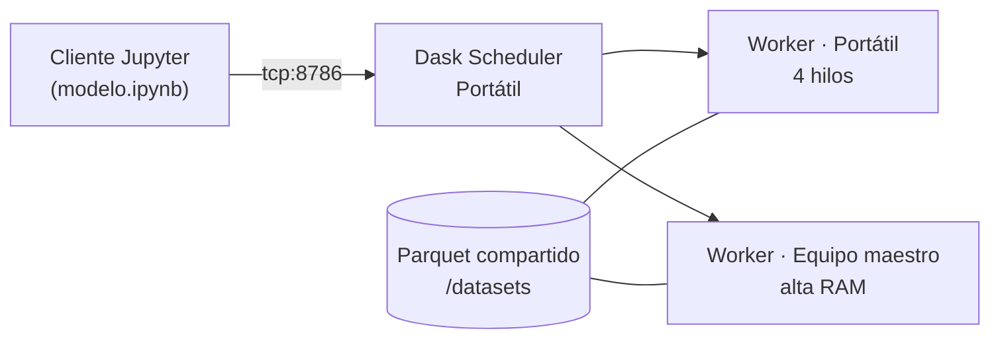

# Clasificación de delitos en Los Ángeles con regularización L2: computación distribuida (Dask) vs. local


Proyecto de *machine learning* a escala sobre **~1 millón de registros de delitos del LAPD**. Evalúa si los modelos con **regularización L2** se pueden entrenar de forma viable en un **clúster distribuido con Dask** y compara ese enfoque con un entrenamiento **local** tradicional (pandas + scikit-learn).

---

## Resumen ejecutivo

- **Problema:** clasificación multiclase (14 categorías de delito) a partir de variables de la víctima, el lugar, el arma, la ubicación geográfica y el estado del caso.
- **Infraestructura:** clúster Dask montado sobre **2 equipos físicos en red local** (8 hilos y 25.6 GiB de RAM distribuida).
- **Modelo campeón:** **LightGBM con regularización L2** (`reg_lambda = 1.0`), entrenado de forma distribuida y reentrenado sobre train + validación.
- **Resultado:** **accuracy de 0.54 y F1-macro de 0.40 en test**, con una mejora relativa de **+48 % en F1-macro** frente a la regresión logística L2 (0.438 vs. 0.296 en validación).

---

## Contexto y datos

| Atributo | Detalle |
|---|---|
| Fuente | [LAPD – *Crime Data from 2020 to Present*](https://data.lacity.org/Public-Safety/Crime-Data-from-2020-to-Present/2nrs-mtv8/about_data) (Portal de datos abiertos de la ciudad de Los Ángeles) |
| Volumen | **1,004,989 registros** después del preprocesamiento |
| Tamaño | ≈ 350 MB en CSV → **7 MB en Parquet** (compresión columnar) |
| Variables | 53 *features* + 1 *target* |
| Target | 14 categorías de delito (multiclase, **desbalanceado**) |

El volumen supera lo que se suele manejar cómodamente en un portátil durante una búsqueda de hiperparámetros. Por eso es un buen caso para medir **cuándo la computación distribuida aporta valor y cuándo no**.

### Preparación de datos (etapa previa, no incluida en este repositorio)

Antes del modelado se aplicó un pipeline de ciencia de datos con limpieza y depuración de valores faltantes, agrupación semántica de categorías (armas, tipos de lugar, ascendencia y sexo de la víctima), *one-hot encoding*, conversión de latitud y longitud a **radianes** y estandarización (*z-score*) del año de ocurrencia. El resultado se almacenó en **Parquet** para que la lectura distribuida fuera eficiente.

**Grupos de variables:** `arma_cat_*` (9) · `premis_*` (11) · `descent_ctx_*` (20) · `sexo_ctx_*` (3) · `status_*` (6) · `year_occ_z` · `lat_rad` · `lon_rad` · `Vict Age`

---

## Objetivo

> Determinar si los modelos con **penalización L2** se pueden entrenar y optimizar de forma viable **con computación distribuida** (Dask) o **sin ella** (pandas + scikit-learn), y cuál ofrece el mejor equilibrio entre desempeño y costo computacional.

La regularización L2 se evaluó con tres mecanismos:

| Mecanismo L2 | Modelo |
|---|---|
| `penalty='l2'` | Regresión logística multinomial |
| `alpha` (Ridge) | `RidgeClassifier` |
| `reg_lambda` | LightGBM (penalización L2 sobre los pesos de las hojas) |

---

## Arquitectura del clúster



| Nodo | Rol | Scheduler | Worker |
|---|---|:---:|:---:|
| Portátil | Scheduler + cómputo | ✅ | ✅ |
| Equipo maestro | Cómputo (memoria) | — | ✅ |
| **Total del clúster** | **2 procesos · 8 hilos · 25.6 GiB** | | |

El *DataFrame* se reparticionó en **8 particiones** y se persistió en la memoria distribuida (`persist()`) para que todos los workers procesaran en paralelo.

---

## Experimentos

Se usó una partición **70 / 15 / 15** (train / validación / test) con `random_state=42`. La métrica principal fue **F1-macro**, adecuada para clases desbalanceadas.

| # | Experimento | Infraestructura | L2 | Resultado |
|---|---|---|---|---|
| 1 | LightGBM + `RandomizedSearchCV` (100 % de los datos) | Dask | `reg_lambda ∈ {0, 1}` | ❌ No convergió |
| 2 | LightGBM + `RandomizedSearchCV` (muestra del 5 %, rejilla reducida) | Dask | `reg_lambda ∈ {0, 1}` | ❌ Más de 4 h sin terminar |
| 3 | LightGBM con hiperparámetros fijos (muestra del 50 %) | Dask | `reg_lambda = 1.0` | ✅ Acc 0.54 · F1-macro 0.39 (val) |
| 4 | `RidgeClassifier` + `IncrementalPCA` | Dask | `alpha = 1.0` | ❌ No soportado por dask-ml sobre `dask.dataframe` |
| 5 | Regresión logística L2 (`saga`, 100 % de los datos) | Local | `penalty='l2'` | ✅ Acc 0.48 · F1-macro 0.30 (val) |
| 6 | Regresión logística L1 (control) | Local | `penalty='l1'` | ✅ Idéntico a L2 |
| 7 | **Campeón: LightGBM L2 reentrenado (train + val)** | Dask → Local | `reg_lambda = 1.0` | ✅ **Acc 0.54 · F1-macro 0.40 (test)** |

---

## Resultados

### Comparativa de modelos

| Modelo | Infraestructura | Accuracy | F1-macro | F1-weighted |
|---|---|:---:|:---:|:---:|
| Regresión logística L2 | Local | 0.48 | 0.30 | 0.45 |
| Regresión logística L1 | Local | 0.48 | 0.30 | 0.45 |
| LightGBM L2 (muestra del 50 %) | Dask | 0.54 | 0.39 | 0.52 |
| **LightGBM L2 — campeón (test)** | **Dask → Local** | **0.54** | **0.40** | **0.52** |

**Selección del campeón** (F1-macro en validación): LightGBM **0.438** vs. regresión logística **0.296**. El modelo campeón se evaluó **una sola vez** sobre el conjunto de test para evitar fuga de información.

### Desempeño del campeón por clase (test)

| Desempeño | Clases | F1 |
|---|---|---|
| Alto | Clase 3 | **0.88** |
| Medio-alto | Clases 0, 2, 13 | 0.59 – 0.69 |
| Medio | Clases 1, 5, 9 | 0.45 – 0.49 |
| Medio-bajo | Clases 7, 8, 11 | 0.30 – 0.34 |
| Bajo | Clases 4, 6, 10, 12 (minoritarias, < 2.2 k muestras) | 0.02 – 0.21 |

---

## Hallazgos clave

1. **L2 sí funciona en modo distribuido, pero con hiperparámetros fijos.** LightGBM distribuido con `reg_lambda = 1.0` entrenó correctamente sobre el clúster. En cambio, la **búsqueda distribuida de hiperparámetros** (`RandomizedSearchCV`) no convergió en un clúster de 2 nodos, ni siquiera con el 5 % de los datos, por el costo de coordinación entre workers.
2. **El ecosistema dask-ml tiene vacíos reales.** No fue posible usar `RidgeClassifier` ni `IncrementalPCA` directamente sobre `dask.dataframe`, porque dask-ml exige `dask.array`. Elegir una herramienta distribuida obliga a validar antes su cobertura de algoritmos.
3. **Distribuir no siempre es necesario.** Con ~1M de registros y datos en Parquet, el entrenamiento **local fue viable** y más simple de operar. La computación distribuida aporta valor cuando el volumen supera la memoria de un nodo o cuando hay muchos nodos disponibles.
4. **El cuello de botella es la capacidad del modelo, no la regularización.** L1 y L2 dieron resultados idénticos en la regresión logística, y el salto de desempeño llegó al pasar a un modelo **no lineal** (LightGBM), que captura interacciones entre ubicación, lugar, arma y perfil de la víctima.
5. **El desbalance de clases limita el F1-macro.** Las clases con menos de 250 muestras prácticamente no se predicen, aunque se usó `class_weight="balanced"`.

---

## Limitaciones y trabajo futuro

- Aplicar **sobremuestreo o submuestreo** (SMOTE, *focal loss*) o agrupar las clases minoritarias.
- Reemplazar `RandomizedSearchCV` por **Optuna** o **Hyperband**, que son más eficientes en entornos distribuidos.
- Escalar el clúster a más nodos y medir el *speedup* real frente al entrenamiento local.
- Incorporar variables temporales (hora, día de la semana) y espaciales (clústeres geográficos).

---

## Uso del modelo

```python
from joblib import load
import pandas as pd

model = load("champion.pkl")  # lightgbm.LGBMClassifier

# X must contain the same 53 features, in the same order used in training,
# with booleans cast to int8, numeric columns to float32, and NaN filled with 0.
y_pred = model.predict(X)
```

> Requiere `lightgbm` y `scikit-learn` en versiones compatibles con las de entrenamiento (Python 3.13).

---

## Estructura del repositorio

```
├── modelo.ipynb    # Distributed (Dask) and local experiments, L2 vs L1, LightGBM
├── champion.pkl    # Final model: LightGBM with L2 regularization
└── README.md
```

> El notebook conserva las salidas de la ejecución original sobre el clúster. Las rutas y la IP del scheduler corresponden al entorno de laboratorio.

---

## Tecnologías

**Cómputo distribuido:** Dask · Dask Distributed · dask-ml
**Modelado:** LightGBM (`DaskLGBMClassifier`) · scikit-learn
**Datos:** pandas · NumPy · Apache Parquet
**Visualización:** Matplotlib · Seaborn · Plotly · Graphviz
**Persistencia:** joblib

---

## Autor

**Fabián Tovar** · [GitHub](https://github.com/fabiantovarc)

Proyecto académico de *Machine Learning II*.
