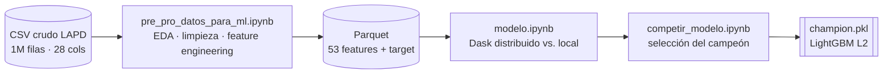
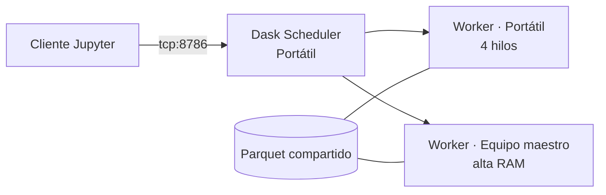

# Clasificación de delitos en Los Ángeles con regularización L2: computación distribuida (Dask) vs. local


Proyecto *end-to-end* de ciencia de datos sobre **1 004 989 registros de delitos del LAPD**: desde la minería y el preprocesamiento de los datos crudos hasta el entrenamiento de modelos con **regularización L2** en un **clúster Dask de 2 nodos** y su comparación con el entrenamiento **local**.

---

## Resultados en 30 segundos

| | |
|---|---|
| **Problema** | Predecir la categoría de un delito (14 clases) a partir de la víctima, el lugar, el arma, la ubicación y el estado del caso |
| **Datos** | ~1M registros · 28 columnas crudas → 53 *features* |
| **Infraestructura** | Clúster Dask con 2 equipos físicos (8 hilos, 25.6 GiB de RAM distribuida) |
| **Modelo campeón** | LightGBM con L2 (`reg_lambda = 1.0`) |
| **Desempeño (test)** | **Accuracy 0.54 · F1-macro 0.40 · F1-weighted 0.52** |
| **Mejora vs. baseline** | **+48 % en F1-macro** frente a la regresión logística L2 (0.438 vs. 0.296 en validación) |
| **Hallazgo principal** | L2 es viable en modo distribuido, pero a este volumen **distribuir no compensa**: el entrenamiento local resultó más simple e igual de efectivo |

---

## Flujo del proyecto



| Etapa | Notebook | Qué demuestra |
|---|---|---|
| 1. Minería y preprocesamiento | [`pre_pro_datos_para_ml.ipynb`](pre_pro_datos_para_ml.ipynb) | Análisis exploratorio, calidad de datos, *feature engineering*, *insights* |
| 2. Modelado distribuido vs. local | [`modelo.ipynb`](modelo.ipynb) | Dask, LightGBM distribuido, regularización L1/L2, límites del ecosistema |
| 3. Selección del campeón | [`competir_modelo.ipynb`](competir_modelo.ipynb) | Comparación justa, reentrenamiento y evaluación única en test |

---

## Datos

- **Fuente:** [LAPD – *Crime Data from 2020 to Present*](https://data.lacity.org/Public-Safety/Crime-Data-from-2020-to-Present/2nrs-mtv8/about_data), portal de datos abiertos de la ciudad de Los Ángeles.
- **Volumen:** 1 004 989 registros (2020–2024), unos 245 MB en CSV crudo.
- **Target:** 14 categorías de delito construidas a partir de unos 140 códigos de delito originales.

---

## 1. Minería y preprocesamiento

Esta etapa redujo **28 columnas crudas, con alta cardinalidad y muchos nulos, a 53 *features* numéricas** listas para modelar.

| Decisión | Motivo |
|---|---|
| Agrupar unos 140 códigos de delito en **14 categorías** (tomando como referencia la clasificación del FBI) | Reducir la dimensionalidad del *target* y obtener clases interpretables |
| Agrupar los códigos de arma en **9 subcategorías** y los lugares en **11 tipos** | Evitar la explosión de columnas en el *one-hot encoding* |
| Descartar `Crm Cd 2/3/4`, `Cross Street` y `Mocodes` | Más del 84 % de nulos (más del 15 % en `Mocodes`), o información redundante con el delito principal |
| Normalizar el sexo de la víctima (`H`, `-` → `X`) y decodificar la ascendencia (20 grupos) | Corregir códigos inconsistentes |
| Pasar latitud y longitud a **radianes** y estandarizar el año (*z-score*) | Escalas comparables para los modelos lineales |
| Guardar los diccionarios de mapeo en JSON | Trazabilidad e inferencia reproducible |
| Exportar a **Parquet** | El dataset preprocesado pasa de 338 MB en CSV a **7 MB**, con lectura columnar eficiente para Dask |

**Algunos *insights* del análisis exploratorio:**

- **Robo y hurto (18.5 %), agresión y violencia (15.7 %) y allanamiento (14.4 %)** suman casi la mitad de los delitos.
- **Viernes (15.1 %) y sábado (14.9 %)** son los días con más incidentes.
- La división **Central** es la que acumula más delitos (69 670).
- Más del **79 %** de los casos sigue en investigación (`Invest Cont`).

---

## 2. Modelado: distribuido vs. local

### Objetivo

> Determinar si los modelos con **penalización L2** se pueden entrenar y optimizar de forma viable **con computación distribuida** (Dask) o **sin ella** (pandas + scikit-learn).

| Mecanismo L2 | Modelo |
|---|---|
| `penalty='l2'` | Regresión logística multinomial |
| `alpha` (Ridge) | `RidgeClassifier` |
| `reg_lambda` | LightGBM (penalización L2 sobre los pesos de las hojas) |

### Arquitectura del clúster



El *DataFrame* se reparticionó en **8 particiones**, se convirtió a `int8`/`float32` para reducir memoria y se persistió en la RAM distribuida (`persist()`).

### Experimentos

Partición **70 / 15 / 15** (train / validación / test), `random_state=42`. Métrica principal: **F1-macro**, por el desbalance de clases.

| # | Experimento | Infraestructura | L2 | Resultado |
|---|---|---|---|---|
| 1 | LightGBM + `RandomizedSearchCV` (100 % de los datos) | Dask | `reg_lambda ∈ {0, 1}` | ❌ No convergió |
| 2 | LightGBM + `RandomizedSearchCV` (muestra del 5 %, rejilla reducida) | Dask | `reg_lambda ∈ {0, 1}` | ❌ Más de 4 h sin terminar |
| 3 | LightGBM con hiperparámetros fijos (muestra del 50 %) | Dask | `reg_lambda = 1.0` | ✅ Acc 0.54 · F1-macro 0.39 |
| 4 | `RidgeClassifier` + `IncrementalPCA` | Dask | `alpha = 1.0` | ❌ No soportado por dask-ml sobre `dask.dataframe` |
| 5 | Regresión logística L2 (`saga`, 100 % de los datos) | Local | `penalty='l2'` | ✅ Acc 0.48 · F1-macro 0.30 |
| 6 | Regresión logística L1 (control) | Local | `penalty='l1'` | ✅ Idéntico a L2 |

---

## 3. Selección del campeón

Los dos mejores candidatos se compararon sobre **el mismo conjunto de validación** (partición estratificada idéntica):

| Candidato | F1-macro (val) |
|---|:---:|
| **LightGBM L2** | **0.438** |
| Regresión logística L2 | 0.296 |

El ganador se **reentrenó con train + validación** y se evaluó **una sola vez** sobre test para evitar fuga de información.

### Desempeño del campeón por categoría (test)

| Categoría | F1 | | Categoría | F1 |
|---|:---:|---|---|:---:|
| Delitos con vehículos | **0.88** | | Vandalismo | 0.34 |
| Agresión y violencia | 0.69 | | Incendio provocado | 0.33 |
| Delitos contra menores | 0.64 | | Otros | 0.30 |
| Violencia doméstica | 0.59 | | Violaciones de armas | 0.21 |
| Robo y hurto | 0.49 | | Delitos sexuales | 0.12 |
| Fraude y falsificación | 0.48 | | Homicidio | 0.08 |
| Allanamiento y robo en propiedad | 0.45 | | Secuestro | 0.02 |

---

## Decisiones técnicas clave

| Decisión | Por qué | Impacto |
|---|---|---|
| Parquet en lugar de CSV | Lectura columnar y tipos preservados | Archivo unas 48 veces más pequeño y lectura distribuida directa |
| `int8` / `float32` en lugar de `int64` / `float64` | El clúster tenía RAM limitada | Menor huella de memoria al persistir |
| Abandonar `RandomizedSearchCV` distribuido | No convergió ni con el 5 % de los datos | Se pasó a hiperparámetros fijos razonables |
| Muestra del 50 % para Dask | Equilibrio entre representatividad y tiempo | Desempeño casi igual al del modelo final (F1-macro 0.39 vs. 0.40) |
| F1-macro como métrica de selección | La accuracy oculta el mal desempeño en clases minoritarias | Selección más honesta del campeón |
| Evaluar en test una sola vez | Evitar sobreajuste al conjunto de test | Métrica final confiable |

---

## Hallazgos

1. **L2 sí funciona en modo distribuido, pero con hiperparámetros fijos.** La búsqueda distribuida de hiperparámetros no convergió en un clúster de 2 nodos por el costo de coordinación entre workers.
2. **El ecosistema dask-ml tiene vacíos reales.** `RidgeClassifier` e `IncrementalPCA` no funcionan directamente sobre `dask.dataframe`. Elegir una herramienta distribuida obliga a validar antes su cobertura de algoritmos.
3. **Distribuir no siempre es necesario.** Con ~1M de registros en Parquet, el entrenamiento local fue viable y más simple de operar. Dask aporta valor cuando los datos superan la memoria de un nodo o cuando hay más nodos disponibles.
4. **El cuello de botella es la capacidad del modelo, no la regularización.** L1 y L2 dieron resultados idénticos. El salto de desempeño llegó con un modelo **no lineal** (LightGBM), capaz de capturar interacciones entre lugar, arma, ubicación y perfil de la víctima.
5. **El desbalance de clases limita el F1-macro.** Homicidio y secuestro (menos del 0.2 % de los datos) prácticamente no se predicen. El modelo campeón se entrenó sin pesos por clase.

---

## Limitaciones y trabajo futuro

- El 27 % de los registros tiene `Vict Age = 0`, que probablemente significa una edad desconocida. Convendría tratarlo como un valor faltante explícito.
- Entrenar el campeón con `class_weight="balanced"`, aplicar sobremuestreo (SMOTE) o *focal loss*, o agrupar las clases minoritarias.
- Reemplazar `RandomizedSearchCV` por **Optuna** o **Hyperband**.
- Incorporar variables temporales (hora, día de la semana) que ya se calcularon pero no entraron al modelo.
- Escalar el clúster y medir el *speedup* real frente al entrenamiento local.

---

## Uso del modelo

```python
from joblib import load

model = load("champion.pkl")  # lightgbm.LGBMClassifier

# X must contain the same 53 features, in the same order used in training,
# with booleans cast to int8, numeric columns to float32, and NaN filled with 0.
y_pred = model.predict(X)
```

**Etiquetas del modelo** (orden del `LabelEncoder`):
`0` Agresión y Violencia · `1` Allanamiento y Robo en Propiedad · `2` Delitos Relacionados con Menores · `3` Delitos Relacionados con Vehículos · `4` Delitos Sexuales · `5` Fraude y Falsificación · `6` Homicidio · `7` Incendio Provocado · `8` Otros · `9` Robo y Hurto · `10` Secuestro · `11` Vandalismo · `12` Violaciones de Armas · `13` Violencia Doméstica

---

## Estructura del repositorio

```
├── pre_pro_datos_para_ml.ipynb   # EDA, data cleaning and feature engineering
├── modelo.ipynb                  # Distributed (Dask) vs local experiments, L1/L2, LightGBM
├── competir_modelo.ipynb         # Champion selection and final test evaluation
├── champion.pkl                  # Final model: LightGBM with L2 regularization
└── README.md
```

> Los notebooks conservan las salidas de su ejecución original. Las rutas y la IP del scheduler corresponden al entorno de laboratorio, y los datos crudos no se incluyen por su tamaño (se descargan desde la fuente oficial).

---

## Tecnologías

| Área | Herramientas |
|---|---|
| Cómputo distribuido | Dask · Dask Distributed · dask-ml |
| Modelado | LightGBM (`DaskLGBMClassifier`) · scikit-learn |
| Datos | pandas · NumPy · Apache Parquet |
| Visualización | Matplotlib · Seaborn · Plotly · Graphviz |
| Persistencia | joblib · JSON |

---

## Autor

**Fabián Tovar** · [GitHub](https://github.com/fabiantovarc)

Proyecto académico de *Machine Learning II*.
